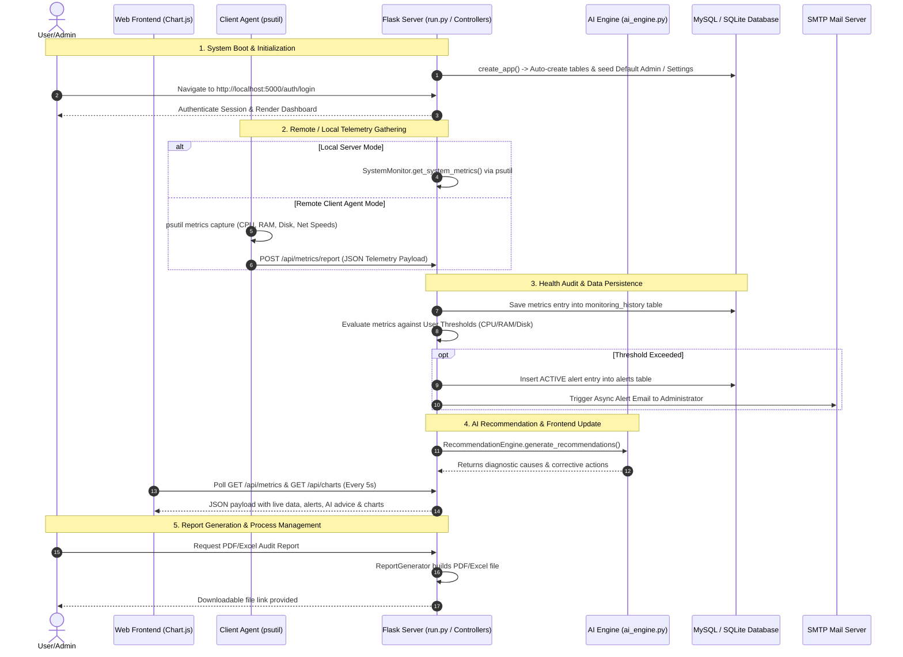

# End-to-End System Workflow & Architecture

## 1. System Execution Flow (First to Last)

---

## 2. Core Subsystems Breakdown

### Step 1: Telemetry Collection Subsystem (`system_monitor.py` / `client_agent.py`)
- Reads CPU usage percentage, core count, frequency.
- Reads RAM total, used, available, and percentage.
- Reads Disk volume total, free, used, and percentage.
- Dynamically computes real-time Network upload/download speeds in KB/s using socket/net_io deltas.
- Extracts process list (Top 10 CPU/RAM consuming tasks with PID, process name, username).

### Step 2: Ingestion & Threshold Audit Subsystem (`dashboard_controller.py`)
- Receives telemetry via REST API or local fetch.
- Saves time-series records to `monitoring_history`.
- Compares metrics against user thresholds (e.g., CPU > 90%, RAM > 90%, Disk > 95%).
- Automatically triggers database alert creation (`Alert` model) and dispatches email notifications (`mail_helper.py`).

### Step 3: AI Diagnostic Engine Subsystem (`ai_engine.py`)
- Rule-based expert system evaluating multiple telemetry variables simultaneously.
- Identifies critical situations like **CPU Core Saturation**, **Physical RAM Depletion**, **Storage Depletion**, and **High Network Upload/Download Throughput**.
- Formulates root causes (e.g., memory leaks, unauthorized cryptomining, log accumulation) and actionable corrective steps.

### Step 4: Real-time UI Rendering Subsystem (`dashboard.html` / `dashboard.js`)
- Uses asynchronous polling (`setInterval` every 5 seconds) via Fetch API.
- Dynamically updates gauges, stat cards, alert feeds, and Chart.js time-series charts without full page refreshes.

### Step 5: Auditing & Reporting Subsystem (`report_generator.py`)
- Compiles custom-range telemetry statistics (mean, max, peak values).
- Generates formatted PDF documents using ReportLab Flowables.
- Generates structured Excel spreadsheets using openpyxl.
